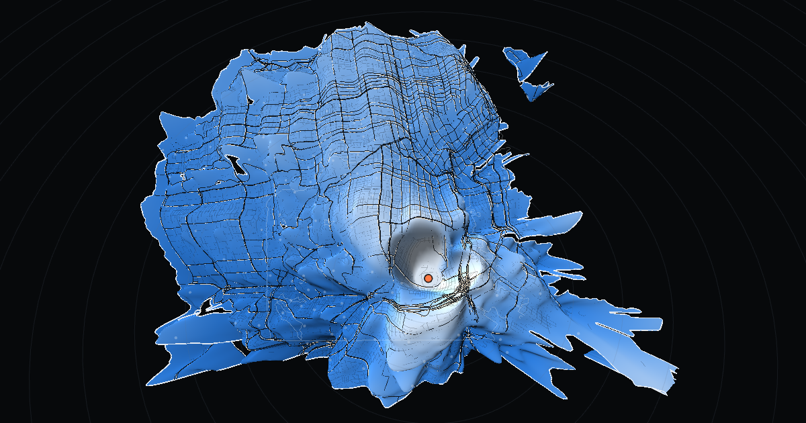

# San Francisco, redrawn by travel time



The San Francisco version of [weighted_map](https://github.com/alexgaoth/weighted_map). Pick
any point in the city, a way of getting around, and an hour of the week. Every other point
keeps its true compass bearing from you, and its distance becomes **how long it takes to get
there**: one minute is 500 m of map. Walk, bike, car, or a helicopter you can't actually hire.

The US map precomputed travel-time fields for 253 fixed origins. SF is small enough that the
page ships the whole street graph — 95,587 nodes, 215,823 directed edges — and **routes in the
browser**. Any point can be the origin, any quarter-hour of the week, and switching modes is
instant. A [graphs page](dist/graphs.html) measures the city's week with the same router, and
the two are checked against each other to the second (`src/25_check_parity.py`).

## The question it answers

A reply to the original post:

> hey this is really cool. then south of Bernal heights to Oakland (and therefore union
> square) must be really bad on a Thursday 4:30-5:00pm … especially when a lanes closed for
> construction.

It is. Bernal Heights to Union Square by car takes **14.8 min at 3 am on a Thursday and 23.8
at 5 pm**: +61%. Bernal to Treasure Island, over the Bay Bridge approach she was talking
about, goes from **16.1 min to 31.5**. That nearly doubles. The bike takes 32 minutes whatever
the hour, and walking takes 90. The map opens on exactly that trip and hour. The lane closures
aren't modelled; see the limits.

## Running it

```bash
uv venv --python 3.12 .venv
uv pip install --python .venv/bin/python numpy scipy pandas matplotlib geopandas shapely pyproj requests rasterio
(cd tools && npm install)          # puppeteer-core, for the two headless checks

.venv/bin/python src/01_fetch_osm.py        # streets, places, lakes      -> data/raw/   (Overpass)
.venv/bin/python src/02_fetch_context.py    # lidar DEM, shoreline, neighbourhoods, signals, stop signs, pads
.venv/bin/python src/03_fetch_traffic.py    # SFCTA INRIX speeds + segments, four months of taxi trips
.venv/bin/python src/05_build_graph.py      # the costed street graph     -> data/graph.npz  (~2 min)
.venv/bin/python src/06_build_mesh.py       # the warpable sheet, lines, the 40 m time grid
.venv/bin/python src/07_traffic.py          # 1,464 hour-of-week speed profiles
.venv/bin/python src/08_places.py           # 162 named places
.venv/bin/python src/20_build_payload.py    # everything the page routes on -> data/payload.npz
.venv/bin/python src/21_measure.py          # week curves + colour spans    (~2 min, 8 cores)
.venv/bin/python src/22_validate_taxi.py    # the car model vs 12,096 taxi rides (~3 min; --sweep to recalibrate)
.venv/bin/python src/23_stats.py            # everything the graphs page plots (~2 min)
.venv/bin/python src/24_build_dist.py       # dist/index.html, graphs.html, sfmap.bin.gz
.venv/bin/python src/25_check_parity.py     # the live page's router vs the Python one
.venv/bin/python src/26_og_image.py         # dist/og.png
python3 -m http.server -d dist              # it must be served: the page fetches its payload
```

The fetches are polite one-shot downloads and skip anything already in `data/raw/`. Raw
data is not committed. Everything derived from it rebuilds in under fifteen minutes.

## Data

| what | source | licence |
|---|---|---|
| streets, paths, stairs, places, lakes | OpenStreetMap via the Overpass API, 2026-10-17 | ODbL |
| elevation | USGS 3DEP: the 2023 San Francisco lidar at 10 m, default mosaic past the county line | public domain |
| land, neighbourhoods | DataSF *SF Shoreline and Islands*, *Analysis Neighborhoods*, *SF Find Neighborhoods* | PDDL |
| signals, stop signs | SFMTA inventories on DataSF (1,305 signals, 11,131 stop signs) | PDDL |
| car speeds by hour | SFCTA's INRIX speeds on 740 CMP segments (`api.sfcta.org`), Oct 2025–Sep 2026, weekdays | published openly; attribute SFCTA/INRIX |
| the week's shape, and validation | DataSF *Taxi Trips* (SFMTA), Oct–Nov 2023 and Mar–Apr 2024 | PDDL |
| heliports | FAA ADDS and OurAirports | public domain |

## Method

### Walking and cycling

Each edge is costed by walking its geometry in ~10 m pieces against the lidar, uphill and
downhill separately. A street that climbs and then drops pays for both, not for its net grade.

- **Walking** is Tobler's hiking function, scaled so flat ground is 1.34 m/s. It is fastest on
  a gentle descent and slows on steep descents as well as climbs. Stairs use Fruin's measured
  0.50 m/s up and 0.60 down.
- **Cycling** is a 150 W rider on an ordinary bike, 90 kg with it. Cruise is capped at 18 km/h
  on the flat and 30 km/h on gentle descents. Steeper than 6% the rider is braking: the cap
  falls to 9 km/h by a 30% drop. Below walking pace they get off and push.

Neither has a rush hour. That is a finding, not an omission: every graph of the week shows it.

Signals cost 12 s on foot, 15 by bike and 18 by car. Stop signs cost 0, 4 and 7 s. SF's stop
signs are mostly all-way, so every approach pays. The cost lands on the edge arriving at the
signal or sign.

### Driving, hour by hour

1. **Free flow:** OSM's posted speeds (SF's default is 25 mph) plus the intersection delays above.
2. **Each street's day:** SFCTA's INRIX data gives every segment of the Congestion Management
   Program network a weekday multiplier for each hour, read against that segment's own night
   speed. That network is every arterial plus I-80, US-101 and I-280. 730 segments have data
   and are matched to 30,351 graph edges, 899 km in all. SFCTA draws each direction 10–20 m off
   the centreline and against its own direction of travel (724 of 740), so the matcher flips
   them, reaches 30 m, and requires the same direction and road class.
3. **The week:** a factor for each (day, hour) comes from 411,244 clean taxi trips. It is that
   hour's time per km over the Mon–Fri mean, which is the same weekday mean SFCTA's numbers are.
   Saturday at 8 am is 0.83 and Sunday at 8 am 0.79. Thursday at 5 pm is 1.03 and Monday at 5 pm
   0.93. Freeway ramps queue with the freeway they join.
4. **Side streets** borrow an inverse-distance blend of nearby arterials' slowdown, damped. Minor
   arterials take 80% of it and local streets 50%. **That damping is a choice, not a
   measurement.**
5. **Calibration:** the slowdown over free flow is scaled by a gain and the whole thing by a bias.
   Both are fitted once against taxi rides (`22_validate_taxi.py --sweep`):

| gain | taxi / model | hourly r | spread of hourly ratios |
|---|---|---|---|
| 1.0 | 0.994 | 0.78 | 0.056 |
| **1.3** | **0.986** | **0.81** | **0.051** |
| 1.6 | 0.981 | 0.81 | 0.052 |
| 1.9 | 0.979 | 0.81 | 0.058 |

Gain 1.3 is where the model's hour-to-hour slowdown tracks the taxis' most closely. It ships
with bias 0.986 (`CONGESTION_GAIN`, `CAR_BIAS` in `07_traffic.py`). Checked as built against
12,096 rides spread evenly over all 168 hours, the model's time for the same pickup and
dropoff at the same hour is **1.000× the real ride (median)**. The IQR is 0.84–1.21, and a
typical single trip is off by 18%. The rides' ends are rounded to ~100 m and cabs don't always
take the quickest route. The model drives curb to curb, like a maps app: **no parking**.

### The helicopter

A what-if: a helicopter waiting at whichever of SF's five FAA-listed pads suits you. Those are
the Hall of Justice, UCSF Mission Bay, the VA at Fort Miley, the Police Pistol Range at Lake
Merced, and Treasure Island, all private-use. The trip drives to a pad, then 10 min to board
and spin up, 3 min for take-off and landing, 120 kn in a straight line, and 3 min to shut down.
It then drives from the far pad. The time shown is the better of that and just driving.

### The time field and the warp

The page runs Dijkstra four ways from the origin: walk, bike, car at the chosen quarter-hour,
and car from each pad for the helicopter. It then fills a 40 m grid over the city. Each cell is
reached through the best of its three nearest usable nodes plus the walk in. A car only stops
where it can pull over, never on a freeway, a ramp, a bridge deck or in a tunnel, and nothing
starts on a disconnected scrap of network. Cells more than 1 km from any usable node can't be
reached: Treasure Island on foot or by bike, and the fenced tip of the Hunters Point Shipyard.
They are dropped from the sheet.

The sheet is drawn from that field smoothed over ~100 m. A cell 200 m into a park carries 2.5
minutes of walking in, which at 500 m of map per minute would be a spike a kilometre long. The
numbers on screen — tips, medians, graphs — come from the exact field. Piers and spits narrower
than ~90 m are opened out of the drawn land for the same reason. They are still routed.

Colour is the stretch: time-distance over true distance, read as a straight-line speed. Each
mode has its own span, measured over the week. In 3-D the same quantity is the height, faded
out within ~900 m of the origin, where the ratio measures the walk to the car and the first
corner rather than the city.

## What it shows

- **Only the car has a rush hour.** The typical trip from a named place to the rest of SF
  takes 1 h 33 on foot and 34 min by bike, every hour. By car it runs from 13.0 min at Sunday
  5 am to 20.2 at Thursday 5 pm: **+55%**. The worst weekday morning is +53%. Saturday's worst
  hour is +49% and Sunday's +39%, both in the afternoon.
- **The bike beats the car on 2.1% of trips at the worst hour, curb to curb.** Give the driver
  5 minutes to park and it wins 20%; give them 10 and it wins 45%. At the calmest hour those are
  7% and 21%.
- **Freeways swing hardest**: 2.59× their night time at Thursday 5 pm. Major arterials reach
  1.48×, minor arterials 1.28× and local streets 1.15×.
- **The helicopter almost never wins.** It beats driving on 2.7% of trips between named places
  at the worst hour and 0.1% at the calmest. Where it wins, it is the islands: Treasure Island to
  Fort Miley is 1 h 04 by car at Thursday 5 pm and 25 min by air.
- **Walking cares which way you go.** Lakeshore up to Twin Peaks is 1 h 42 and back down is
  1 h 26. 14% of walks between named places are more than 10% slower in one direction.
- **The centre is not downtown.** At the worst hour, Westwood Highlands, Miraloma Park and
  Sunnyside reach the median spot in SF in about 16 minutes. Fisherman's Wharf needs 31 and
  Treasure Island 45.

## Known limits

- **No parking, and no turn restrictions.** A car is timed curb to curb. Illegal turns are
  allowed, so some downtown trips come out a little short.
- **Weekends are scaled, not measured, street by street.** SFCTA publishes weekdays only. Every
  street's weekend comes from its own weekday shape times the city's taxi-derived factor for that
  day and hour.
- **Side streets are inferred.** INRIX covers the arterials. Everything else borrows a damped
  share of them.
- **No incidents or lane closures.** These are typical conditions over twelve months, not a
  particular afternoon.
- **The taxi check has its own biases.** Two thirds of the rides start in the city's northeast
  quadrant and 6% in the southwest, so the check is strongest downtown. The rides' ends are
  rounded to 100 m.
- **The helicopter is a fantasy.** Every pad in SF is private-use.

## Output

- `dist/index.html` + `dist/sfmap.bin.gz`: the map, 2.5 MB of payload, a static site
- `dist/graphs.html`: the week, nine charts, every one with its numbers
- `dist/og.png`: the link preview
- `data/validation.json`, `data/stats.json`, `data/curves.npy`: everything measured
